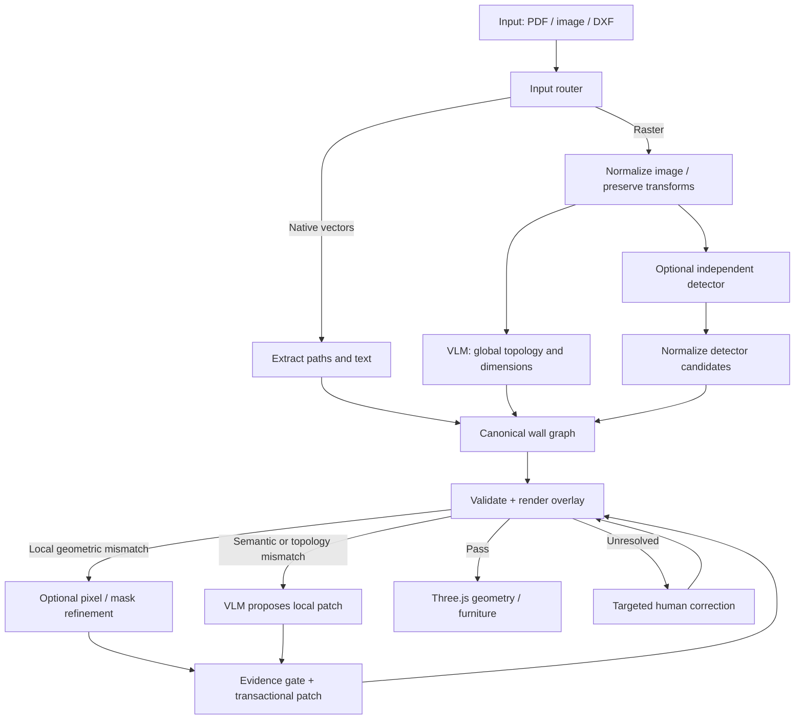

> Внешний источник, не канон: утверждения не проверены, даты и ссылки могут быть выдуманы. Критическая оценка — Fable `~/remlab-logs/fable-1126/otvet-3.md`, решения — в `plans/etazhi-walls-model-01.md`.

# Глубокое исследование: что лучше всего распознаёт плохие 2D‑планировки в структурированную геометрию

## Краткий вывод

На 26 ноября 2026 года я **не нашёл ни одного коммерческого API, для которого существовало бы независимое публичное исследование вида «взяли одни и те же плохие планы БТИ/рукописные планы и объективно сравнили Tectly, RasterScan, ton731, Planner 5D и т. д.»**. Поэтому честно назвать победителя среди готовых API по независимым данным нельзя. Это важный результат исследования сам по себе: почти все коммерческие заявления о «hand-drawn», «scans», «any floor plan» сейчас подтверждены в основном самим поставщиком, а не независимым тестированием. citeturn388038search15turn501397view2turn501397view1

Зато в научной и open-source части картина гораздо яснее. **Самый сильный подтверждённый кандидат по качеству реконструкции геометрии на разнообразных реальных планах сейчас — Raster2Seq, Cornell, SIGGRAPH 2026.** Он показывает SOTA на CubiCasa5K и других стандартных бенчмарках и отдельно демонстрирует перенос на WAFFLE — большой набор реальных планировок из интернета с существенно более разнообразной геометрией. На CubiCasa5K у него Room F1 88,7%, Corner F1 59,4%, Window & Door F1 77,8%; RoomFormer, например, имеет Room F1 83,5% и Window & Door F1 78,5%. Это не тест именно на размазанных БТИ-сканах, но из всех найденных моделей это один из наиболее убедительных head-to-head результатов. citeturn205669search2turn205669search3turn388038academia48

**Самое интересное исследование именно плохих сканов — Floor Plan Tracer и особенно свежая работа Carrara et al. “Why floor plan object detection breaks under real scans” от ноября 2026 года.** Последняя показывает, что на реальных сканах главный источник ошибок — не просто шум бумаги, а изменение самого изображения тонких геометрических элементов; особенно резко падает точная локализация маленьких объектов, дверей, окон и тонких линий. То есть обычный `contrast + threshold + detector` проблему полностью не решает. citeturn205669search7turn340197search0

Если задача RemLab — **30 000 российских планировок в месяц**, мой shortlist для реального пилота выглядит так:

| Кандидат | Почему в топ‑3 | Уверенность |
|---|---|---|
| **Raster2Seq** | Лучшие найденные независимые/академические сравнительные результаты для структурированной геометрии; хорошо переносится на сложные real-world планы | **Высокая как технология**, средняя для плохих БТИ |
| **Tectly** | Самый подходящий готовый API: стены, комнаты, двери, окна, масштаб, topology, JSON; заявлена работа со сканами и hand sketches | **Средняя**, потому что независимых тестов почти нет |
| **Floor Plan Tracer** | Единственный найденный pipeline с очень подробной количественной оценкой именно на тысячах реальных сканов и геометрической постобработкой | **Средне-высокая как research baseline**, но не production API |

**ton731 я бы обязательно добавил четвёртым в тест**, потому что он практически бесплатен и self-hostable, но у него пока нет убедительного независимого benchmark-а качества. RasterScan я бы тоже проверил как пятого, однако его текущее операционное состояние вызывает серьёзные вопросы из-за нескольких независимых сообщений пользователей о неработающем API и отсутствии ответа поддержки весной 2026 года. citeturn501397view1turn809975view0

## Что говорят реальные пользователи, а не маркетинг

Именно здесь результаты оказались наиболее показательными.

У **Planner 5D** есть большое количество пользовательских отзывов, но найденные отзывы не подтверждают высокую надёжность автоматического распознавания. В одном из верифицированных отзывов G2 пользователь прямо пишет, что загрузка собственной планировки «не полностью сработала»: несколько стен и комнат были интерпретированы неправильно, после чего геометрию пришлось корректировать вручную. G2 на октябрь 2026 года показывает 183 отзыва о Planner 5D в целом, но подавляющее большинство относится к редактору и дизайну, а не к recognition, поэтому общий рейтинг 4,7/5 использовать как оценку распознавания нельзя. citeturn190183search2

Более того, собственная инструкция Planner 5D фактически подтверждает слабое место: компания рекомендует **не использовать blurry/low-resolution изображения, фотографии под углом, низкий контраст, тени и рукописные планы**. Для вашей задачи это почти точный список входных данных, на которых система должна работать, поэтому Planner 5D я бы исключил из серьёзного пилота RemLab. citeturn190183search0turn190183search1

У **RoomSketcher** ситуация похожая. В сентябре 2026 года пользователь Trustpilot описал AI import как крайне неудачный даже на чистом исходнике; RoomSketcher официально ответил, что AI Convert всё ещё находится в beta и иногда ошибается, несмотря на обучение на десятках тысяч планов. Это особенно ценно как свидетельство, потому что сам поставщик фактически признал проблему распознавания. citeturn190183search4

При этом отзывы Capterra о RoomSketcher в основном положительные, но они часто касаются ручной отрисовки, интерфейса или сервиса blueprint upload. Один пользователь прямо отмечает необходимость вручную трассировать и расставлять двери и окна. Поэтому высокий пользовательский рейтинг RoomSketcher нельзя интерпретировать как доказательство хорошего автоматического CV-recognition. citeturn190183search3

Старый, но полезный Reddit-тред показывает ту же проблему: пользователь первоначально решил, что RoomSketcher автоматически конвертирует blueprint, а затем выяснил, что на тот момент изображение фактически трассировалось человеком. Это не характеризует сегодняшний AI Convert напрямую, но хорошо показывает, почему нельзя смешивать «у сервиса есть blueprint conversion» и «сервис автоматически точно распознаёт geometry». citeturn190183reddit5

Для **RasterScan** независимых отзывов именно о качестве геометрии практически нет. Зато есть важная эксплуатационная информация. В GitHub issue от 9 апреля 2026 года клиент сообщил, что оплаченный API с более чем 4 000 credits перестал возвращать результаты, а запросы по email и WhatsApp остались без ответа. В комментариях ещё два пользователя сообщили о той же проблеме. Issue на момент последнего индексирования остаётся открытым. Для production-системы на 30 000 планов/месяц это серьёзный риск вне зависимости от качества самой модели. citeturn809975view0

Кроме того, RasterScan нельзя считать обычным open-source-проектом: GitHub содержит Docker-инструкции и API endpoints, но пользователи несколько лет просили открыть исходный код; разработчик отвечал, что предлагает on-premise solution. Таким образом, self-hosting возможен как коммерческое закрытое решение, а не как полностью открытая модель, которую можно самостоятельно модифицировать. citeturn501397view2turn809975view1

Для **Tectly** мне не удалось найти сопоставимого количества независимых Reddit/GitHub/G2 отзывов именно о качестве recognition. Есть документация, SDK и сторонние обзоры, но найденные сторонние обзоры в основном пересказывают характеристики продукта, а не публикуют собственные тестовые наборы с ground truth. Поэтому утверждение Tectly о поддержке scans и hand sketches необходимо считать **vendor claim**, пока вы сами его не проверите. citeturn388038search8turn388038search25turn388038search15

## Что действительно показали независимые исследования на плохих изображениях

Самая важная найденная работа для вашей задачи опубликована в **Automation in Construction в ноябре 2026 года**: Carrara, Nousias и Borrmann специально исследовали, почему модели распознавания ломаются при переходе от нормальных цифровых планов к реальным сканам. Они создали парные версии одних и тех же планировок CubiCasa5K — CAD-подобную и scan-like — чтобы геометрия была идентичной, а менялось только визуальное представление. citeturn205669search7turn340197search0

Результат принципиально важен: падение качества вызывается прежде всего **изменением изображения самой геометрии внутри ROI**, а не просто фоном, пятнами бумаги или окружающим шумом. Строгие метрики локализации, такие как AP75 и IoU≥0.75, деградируют намного сильнее, чем грубое «объект примерно найден» при AP50. Авторы проверили эффект на RT-DETR, Faster R-CNN и RetinaNet и получили одинаковую качественную закономерность; при этом они специально предупреждают, что работа не предназначена для объявления одной из этих архитектур победителем. citeturn205669search7

Это хорошо объясняет практическую проблему БТИ: модель может сказать «здесь дверь», но ошибиться на несколько пикселей или неправильно соединить два тонких сегмента стены. Для 2D→3D это намного хуже, чем просто пропустить подпись, потому что возникает неправильная топология помещения. Исследователи опубликовали и датасет CubiCasa5k-ScanShift, и код, и checkpoints, поэтому этот benchmark можно непосредственно использовать в инженерном тестировании RemLab. citeturn340197search0

Очень полезен также **Floor Plan Tracer**, выпущенный в 2026 году. Его авторы работали не с красивыми картинками размером 256×256, а с реальными сканами: корпус включает 6 848 этажей из 1 348 проектов, медианная длинная сторона исходного скана около 5 100 пикселей, а модель обрабатывает изображение окнами 1536×1536 вместо уменьшения всего плана до одного маленького изображения. Авторы прямо объясняют, что уменьшение большого плана до 1024×1024 превращает один пиксель в несколько сантиметров и делает точную локализацию практически бессмысленной. citeturn501397view3

На development panel из 64 этажей без ручной коррекции Floor Plan Tracer получил следующие результаты:

| Элемент | Boundary F1 при допуске 5 см | Instance F1 при IoU ≥ 0,5 |
|---|---:|---:|
| комнаты | 82,9% | 89,8% |
| двери | 76,0% | 70,9% |
| окна | 72,9% | 72,0% |
| внешний контур | 71,0% | 97,2% |
| балконы | 65,4% | 92,8% |

Это не независимый test set: сами авторы честно пишут, что эти 10 проектов использовались во время разработки, поэтому результаты нельзя трактовать как внешний benchmark. Но это одна из немногих найденных систем, где разработчики показывают **именно сантиметровую точность геометрических границ**, а не только pixel IoU. citeturn501397view3

Архитектура Floor Plan Tracer очень похожа на то, что я бы рекомендовал для RemLab: U-Net++/EfficientNet-B3 делает segmentation, затем отдельная детерминированная геометрическая цепочка превращает masks в polygons, выравнивает стены, убирает zig-zags, связывает openings со стенами и проверяет геометрические ограничения. То есть нейросеть не является последней инстанцией — после неё работает geometry engine. citeturn501397view3

Есть и старый датасет **CVC-FP**, специально собранный из 122 отсканированных планов разного качества, разрешения и архитектурного стиля; он размечен по комнатам, стенам, дверям и окнам. Это один из полезных наборов для дополнительной независимой проверки устойчивости к style/domain shift. citeturn340197search1

## Какие модели сейчас технически сильнее всего

**Raster2Seq** сейчас выглядит самым убедительным general-purpose кандидатом. В SIGGRAPH 2026 авторы отказались от классической схемы «segmentation → куча эвристик» и генерируют последовательность полигонов с координатами и semantic labels. В опубликованном сравнении на CubiCasa5K Raster2Seq имеет Room F1 88,7 против 83,5 у RoomFormer, 78,2 у HEAT и 77,1 у FRI-Net. Corner F1 составляет 59,4, а Window & Door F1 — 77,8. RoomFormer чуть лучше именно по объединённому Window & Door F1 — 78,5, поэтому нельзя говорить, что Raster2Seq выигрывает абсолютно каждую подзадачу. citeturn205669search2turn205669search9

Особенно интересно, что авторы отдельно тестируют модель на **WAFFLE**, который содержит реальные интернет-планировки с разным стилем и сложной геометрией, а не только аккуратно синтезированные планы. Авторы сообщают сильный generalization на WAFFLE; однако это всё ещё их собственный эксперимент, а не независимая лабораторная репликация. citeturn388038academia48turn388038search0

Для production есть неприятный юридический нюанс. Код Raster2Seq распространяется под MIT, однако опубликованные pretrained checkpoints отдельно лицензированы как **CC BY-NC 4.0** и прямо запрещают commercial SaaS inference без отдельного разрешения. То есть RemLab может свободно изучать архитектуру и код, но взять официальный checkpoint и обслуживать им коммерческие 30 000 планов/месяц нельзя без отдельного согласования либо собственного обучения на коммерчески разрешённых данных. citeturn962241view0turn962241view2

**FloorplanVLM** технологически чрезвычайно интересен. В феврале 2026 года авторы показали модель на базе Qwen2.5-VL-3B, которая напрямую генерирует структурированный JSON с общей wall skeleton, координатами, комнатами и openings. На собственном FPBench-2K они сообщают external-wall IoU 92,52%; на non-Manhattan subset — 90,27%, а structural validity превышает 95%. citeturn501397view5

Но FloorplanVLM нельзя сейчас честно назвать лучшим production-вариантом. Эти числа получены авторами на их собственном benchmark, официального production API и официальных weights я не нашёл; доступные GitHub-версии — сторонние reimplementations, причём один независимый обзор open-source решений прямо отмечает, что reimplementation не достигает показателей статьи. citeturn358299search4turn358299search10

**MMParseNet**, опубликованный в IEEE TVCG в феврале 2025 года, показывает интересный другой путь: одновременно использует границы комнат, текстовые названия и furniture/icon cues, а затем делает быструю PCA-vectorization. Авторы провели эксперименты на трёх публичных и одном собственном dataset и сообщают стабильное улучшение качества с total restoration time менее секунды. Однако это не benchmark специально для старых БТИ-сканов и я не нашёл готового официального API или production deployment, поэтому для RemLab это скорее архитектурная идея, чем продукт. citeturn205669search0turn358299search0

Очень показателен новый open-source проект **draw2cad**. Его автор прямо заявляет цель конвертировать scanned, printed-to-PDF и hand-drawn планы в DXF/DWG и публикует не только успехи, но и провалы: mean F1 всего 0,52 на собственном synthetic benchmark; масштаб правильно восстановлен в 10 из 12 тестов; на настоящих листах внешний контур и масштаб обычно хороши, но тонкие внутренние стены часто теряются и из-за этого комнаты сливаются. Такая прозрачность гораздо полезнее маркетингового «99% AI accuracy». citeturn340197search3

Именно эта ошибка — **thin wall missed → two rooms become one** — для RemLab должна считаться критической, даже если обычный segmentation IoU модели высокий. Это согласуется с независимым ScanShift-исследованием, где тонкие и маленькие структуры оказываются наиболее уязвимыми. citeturn340197search0turn340197search3

## Что я бы поставил в пилот RemLab

Мой **первый кандидат — Raster2Seq + собственная геометрическая постобработка**. Уровень уверенности: **высокий, около 8/10 как R&D-база**, но только **6/10 именно для плохих российских БТИ**, потому что прямого независимого теста на вашем домене пока нет. Его преимущество — сильнейшие найденные head-to-head результаты реконструкции и хорошая работа на real-world WAFFLE; недостаток — опубликованные checkpoints нельзя коммерчески использовать без отдельного разрешения. citeturn205669search2turn388038academia48turn962241view2

**Второй кандидат — Tectly как готовый API. Уверенность 6/10.** По функциональности он почти идеально соответствует вашему ТЗ: REST API и SDK, vectorized walls, rooms, doors, windows, scale, alignment grid, room connectivity и связь openings со стенами. Поставщик утверждает поддержку scans, JPEG/PNG/PDF/DWG/DXF и hand sketches; каждому аккаунту даются три бесплатных плана, а enterprise-volume обсуждается индивидуально. Но независимого benchmark на плохих планах я не нашёл, поэтому Tectly нельзя объявлять победителем до собственного blind-test. citeturn501397view0turn134374search3

**Третий кандидат — Floor Plan Tracer. Уверенность 7/10 как контрольная research-система.** Он особенно полезен как benchmark для БТИ-сканов, потому что pipeline изначально рассчитан на большие реальные сканы, сохраняет физический масштаб и выводит GeoJSON в метрах. Главный недостаток — это research baseline, а лицензия PolyForm Noncommercial запрещает коммерческое использование без отдельной лицензии. citeturn501397view3turn962241view3

Я бы ещё обязательно включил **ton731/floorplan-recognition** как дешёвый baseline. Его Replicate-модель сегментирует стены, двери, окна и kitchen zones и возвращает contours/center lines в JSON. Цена сейчас примерно **$0,003 за запуск**, модель работает на CPU, занимает обычно менее 30 секунд, а Replicate прямо сообщает возможность self-hosting через Docker. Но независимых метрик и нормального benchmark-а я не нашёл, поэтому качество ton731 нельзя выводить из его низкой цены или 1,2 тыс. запусков. citeturn501397view1

Для сравнения я бы включил и RasterScan, но только как экспериментальную пятую систему. Он умеет локальный Docker/API и предлагает on-premise, однако отсутствие открытых weights/source и нерешённые жалобы нескольких клиентов на API делают его слишком рискованным в качестве единственного production backend. citeturn501397view2turn809975view0turn809975view1

## Как провести тест на планировках «Этажей», чтобы реально определить победителя

Для вашего объёма я бы вообще **не принимал решение по опубликованным benchmark-ам**. Нужен собственный blind benchmark из российских данных, потому что исследование domain adaptation показывает, что даже между стилями внутри CubiCasa5K возникают заметные различия распределения признаков и неоднозначность разметки; переход к российским БТИ, риелторским сканам и фотографиям телефона будет ещё большим domain shift. citeturn205669search6

Я бы взял **не менее 500 реальных входов** из потока «Этажей», причём намеренно не очищал бы их заранее. Разбивка должна включать примерно 100 нормальных digital plans, 100 старых БТИ/сканов, 75 low-contrast/thin-line, 75 JPEG/низкое разрешение, 75 фотографии под углом/с перспективой и 75 действительно плохих ручных или полу-ручных планов. Ground truth следует один раз вручную восстановить опытными операторами в едином JSON-формате: polygons помещений, wall centerlines/faces, двери, окна, внешний контур и известный масштаб.

Главная метрика не должна быть IoU. Для бизнеса я бы поставил на первое место **Perfect-plan rate**: доля планировок, которые можно сразу отправить в 3D **без ручной геометрической коррекции**. Затем — Critical-topology error rate: объединены ли две комнаты, исчезла ли стена, появился ли невозможный проход, ошибочно ли замкнут контур. Только после этого следует считать Boundary F1 в сантиметрах, Room instance F1, Door F1, Window F1 и scale error. Такой подход согласуется с Floor Plan Tracer, где разница между высоким outline Instance F1 97,2% и Boundary F1 71,0% показывает, насколько вводящей в заблуждение может быть одна «красивая» метрика. citeturn501397view3

Нужно обязательно тестировать каждую систему **на абсолютно одинаковом оригинальном файле**, а затем вторым прогоном — после одинакового deterministic preprocessing: perspective correction, de-skew, CLAHE/contrast normalisation, denoise, upscale и line enhancement. Это покажет отдельно качество recognition engine и выгоду preprocessing. ScanShift paper даёт сильное основание ожидать, что preprocessing поможет, но не устранит ошибки в тонкой геометрии полностью. citeturn205669search7

Для 30 000 планировок в месяц я бы также измерял **abstention quality**. Хорошая система должна уметь сказать «уверенность низкая, отправить человеку», а не уверенно создать неправильную квартиру. Если, например, 75% планов проходят автоматически, 20% корректно помечаются для review, а 5% дают незаметно неверную геометрию, это намного хуже системы с 65% auto-pass, 34% review и только 1% silent topology errors.

Именно поэтому наиболее перспективной архитектурой для RemLab мне представляется не один «волшебный AI», а **двухступенчатая система: сильная reconstruction-модель уровня Raster2Seq/Tectly → deterministic geometry validator → fallback на альтернативную модель или human review**. Научные результаты Floor Plan Tracer и ScanShift довольно ясно показывают, что geometric post-processing и контроль топологии остаются необходимыми даже при современной нейросети. citeturn501397view3turn205669search7

**Если нужно выбрать сегодня только один готовый API для первого коммерческого теста — я бы начал с Tectly, но не потому, что доказано, что он самый точный, а потому что он лучше остальных сочетает нужный structured output, API, масштаб и заявленную поддержку hand-drawn/scanned inputs. Если выбирать технологическую основу для собственного решения — Raster2Seq сейчас выглядит сильнее. Если выбирать систему, наиболее убедительно ориентированную именно на реальные плохие сканы — Floor Plan Tracer даёт наиболее полезные публичные количественные данные. Победителя именно на российских плохих планах пока публичные данные не определяют.** citeturn501397view0turn205669search3turn501397view3

---

# Записка 2 — «советник по векторизации планировок» (владелец TG 3186, 26.11)

> Внешний документ как есть; не проверен, императивы не являются правилами проекта. Критическая оценка — Fable (вопрос 6, `~/remlab-logs/fable-1126/otvet-6.md`).

## RemLab — технический советник по векторизации планировок

**Дата:** 26 ноября 2026 г.  
**Адресат:** разработчик RemLab / AI & geometry engineer  
**Статус:** исследовательская записка и план технического эксперимента; не готовая спецификация промышленной точности.

## 1. Рекомендация

Цель — превратить исходную планировку (фото, скан, JPG/PNG, PDF) в редактируемую геометрию, пригодную для детерминированной генерации 3D-сцены Three.js, расстановки мебели реальных размеров и дальнейшей корректировки. Генерация красивой картинки не решает эту задачу.

**Начать с VLM → компактный wall graph → математический валидатор → программная отрисовка → локальная VLM-коррекция.** В параллельной ветке проверить специализированный детектор (ton731, Tectly либо локальную модель) как независимый источник геометрии. OpenCV не включать в обязательную цепочку, пока не измерена его добавочная ценность. Для векторного PDF/DXF использовать отдельный маршрут с извлечением исходных примитивов без растровой реконструкции.

Не считать, что VLM обязательно улучшит любой исходный вектор. Не считать и обратное: на одной проблемной планировке RemLab специализированная сегментация дала множество пропусков и ложных классификаций, но один пример не доказывает бесполезность метода. Нужен парный эксперимент.

Ключевой принцип: **одна геометрическая модель, несколько источников доказательств, детерминированный контроль изменений.**

## 2. Что уже делают другие разработчики и исследователи

| Решение | Реальный принцип работы | Что взять для RemLab | Ограничения |
|---|---|---|---|
| [Planwalk][1] | Универсальная VLM читает изображение и выдаёт JSON стен и проёмов; скрипты валидируют и визуализируют; агент может повторять цикл | Wall-first schema, промпт, валидатор, оценочный harness | Реальные планировки существенно сложнее синтетических; автоматические итерации на реальном наборе не доказаны |
| [FloorPlanParser][2] | CubiCasa5K → геометрический JSON → Gemini Flash получает JSON и изображение → скорректированный JSON | Готовая схема гибридного API и fallback | Валидный JSON не означает точные стены; нет убедительной абляции относительно прямой VLM |
| [floor-plan-analyzer][3] | Claude сначала составляет инвентарь размеров и объектов, затем формирует геометрию; Python сверяет размеры и рисует SVG | Двухэтапная транскрипция, тайлы мелкого текста, размерные ограничения | Нет независимого промышленного бенчмарка; опубликованные размеры тоже могут быть неверно прочитаны |
| [HITOYS][4] | После ошибок Claude Vision автор перешёл к выделению чёрных пикселей стен и ручному редактированию | Негативный практический пример; сохранить ручной fallback | Плохо переносится на неоднородные старые сканы; не доказана универсальность |
| [FloorplanVLM][5] | Qwen2.5-VL-3B, специализированное обучение; структурная сериализация геометрии | Общие стены, ссылки комнат на границы, дуги, специализированный fine-tuning | Дорогой исходный процесс обучения; официальные готовые веса для использования не подтверждены |
| [Raster2Seq][6] | Специализированный авторегрессионный декодер полигонов комнат, дверей и окон | Сильный исследовательский baseline; сравнить с VLM | Готовые веса CC BY-NC 4.0; коммерческое использование требует отдельного разрешения [7] |
| [Raster-to-Graph][8] | Transformer предсказывает узлы и сегменты графа стен | Альтернативный wall-first детектор, ориентир для восстановления стыков | Проверить доступность весов, лицензии, покрытие неортогональных планов и проёмов |
| [fpvec-lab][9] | Сравнивает координатную генерацию и детекцию по heatmap, объединяет независимые результаты | Метрики, benchmark, алгоритмическое слияние выходов | Препринт, показатели нельзя переносить напрямую на коммерческие VLM |
| [SALI-FP][10] | Мультимодальная интерпретация и локальные исправления, ограниченные визуальными доказательствами | Evidence-gated patches, сохранение промежуточных результатов | Аудит структурированных результатов не доказывает безошибочную геометрию |
| [neural_floorplan][11] | SegFormer-B0 + Raster-to-Graph + выравнивание графа по сегментации | Практический пример использования двух независимых геометрических представлений | Экспериментальный проект, не production-ready по умолчанию |
| [FloorPlanNet][12] | DeepLabV3+ → маска → скелетизация и векторизация → редактор | Лёгкий локальный baseline, ONNX, интерактивная калибровка | Приведение к 90° опасно для наклонных фасадов; synthetic-lite модель не равна модели на реальных данных |
| [Tectly][13] | Коммерческое распознавание структурных объектов, экспорт JSON, API, редактор | Внешний контрольный baseline без собственной ML-инфраструктуры | Договор, стоимость, реальные ограничения и точность проверить на своей выборке |
| [RasterScan][14] / [ton731][15] | Готовые варианты распознавания растровых планов | Быстро подключаемые baseline; ton731 уже проверялся в RemLab | Не считать их одной и той же моделью; происхождение, качество, условия лицензии проверять отдельно |

### 2.1. Почему Planwalk и FloorPlanParser — разные эксперименты

Planwalk начинает с интерпретации изображения универсальной VLM. Схема стен с идентификаторами и проёмов, привязанных к стенам, делает вывод компактным. Валидация и рендер позволяют обнаруживать ошибки без угадывания по длинному списку координат.

FloorPlanParser начинает с специализированной сегментации и преобразования в полигоны. В [gemini_verify.py][16] настроен `gemini-3.6-flash` (имя по коду репозитория, заменяемое через окружение). Изображение ограничивается 1600 px по длинной стороне; при ошибке API или схемы возвращается исходная структура. Flash выбран с расчётом на задержку и стоимость. Сравнительного доказательства, что Flash лучше Pro для этой задачи, нет. Исправление классификации/пропусков нельзя путать с точным измерением координат. Мебель, предложенная моделью, должна быть отделена от объектов, реально присутствующих на исходнике.

HITOYS показал противоположный риск: интерпретация комнат не гарантирует правильного положения стен, а даже координаты текстовых надписей могут быть смещены. Это аргумент за внешнюю геометрическую проверку, а не против применения VLM вообще.

### 2.2. Что говорят опубликованные результаты

- **Planwalk:** синтетический тест до 99,6 балла из 100 — демонстрация работоспособности, не точность на реальном рынке. Автор прямо отмечает лёгкость синтетического набора и ограничения теста. Реальный набор — 20 объявлений UK/Польши, эталонные размеры транскрибированы ИИ, не проверены человеком; отдельные модели запускались неоднократно. По нему нельзя установить точность всех современных VLM или эффект полноценного repair-loop. См. [benchmark][17].
- **FloorplanVLM:** авторы заявляют 92,52% IoU внешних стен, обучение на Floorplan-2M и уточнение на HQ-300K, затем оптимизацию геометрических критериев. Это результат специализированно обученной модели, не zero-shot Qwen и не процент полностью правильных квартир.
- **Raster2Seq:** заявлены сильные результаты на Structured3D, CubiCasa5K, Raster2Graph и демонстрации на WAFFLE. Сравнивать следует одинаковые метрики на одинаковых данных; код MIT не снимает ограничений на веса.
- **fpvec-lab (август 2026):** на 296 реальных планах детекция вместо последовательной генерации улучшила wall F1 на 2,7 п.п. при допуске 0,05 и 5,1 п.п. при 0,015. На покрытых обучением чистых рендерах преимущество менялось в пользу генерации. Объединение выходов room-centric и wall-first моделей улучшило wall F1 примерно на 7 п.п. В трёх вариантах передача результата одной модели на вход другой прироста не дала. Это конкретный эксперимент со специализированными моделями, не доказательство бесполезности VLM-коррекции. [Статья][18].
- **SALI-FP (сентябрь 2026):** авторы описали обработку 11 534 разнородных планов, получение структурированных выходов и локальные revisions с контролем исходного изображения. Наличие выхода у каждого плана не равно точности всех стен. [Статья][10].

**Практический вывод:** сравнивать не только «детектор → VLM», но и независимые выходы с алгоритмическим объединением. Последнее имеет отдельное экспериментальное обоснование, пусть и не на стеке RemLab.

## 3. Предлагаемый pipeline



### A. Разделять типы входных данных

1. **PDF с настоящим вектором / DXF / SVG:** извлекать линии, кривые, штриховки, слои и текст напрямую. Для PDF возможен `Page.get_drawings()` в PyMuPDF [19]; проверить AGPL/коммерческую лицензию для способа развёртывания. Для DXF — ezdxf; для SVG — XML-парсер. Даже векторные примитивы ещё нужно классифицировать как стены, двери и размеры.
2. **Скриншот / растр:** сохранить исходное разрешение и ввести единую систему координат. При необходимости обрезать рамки и приводить ориентацию, сохраняя точное обратное преобразование.
3. **Фото листа под углом:** оценивать перспективу и возможность rectification; если масштаб надёжно не восстанавливается, помечать его как неизвестный. Не исправлять перспективу без подтверждённых ориентиров.
4. **План этажа с несколькими квартирами:** выделить целевую квартиру (автоматический сегмент или выбор пользователя). Не считать соседние квартиры частью целевой модели. Сохранять полный контекст для входной двери и границ.

### B. Два уровня чтения изображения

Глобальный проход VLM: число помещений, связность, внешний контур, типы помещений, балкон, вход, стены, видимые размеры и площади, признаки наклонных или дуговых стен. Отдельно извлекать размерные надписи и их привязки к концам размерных линий.

Локальные тайлы: участки с мелким текстом, санузлы, дверные узлы, сложные фасады. У каждого crop должен быть ID, координаты в оригинале, масштаб и перекрытие с соседями. Не создавать отдельную несогласованную систему геометрии на каждый тайл. Возвращать ссылки на существующие элементы и предложения исправлений.

Structured output / JSON Schema снижает ошибки синтаксиса, но не гарантирует точность координат. Передавать VLM размеры исходного холста, явное начало координат, направление Y и соглашение по нормализации.

### C. Каноническая модель RemLab

Хранить единственный граф, а не независимые контуры комнат, стен и проёмов, которые могут противоречить друг другу. Внешние форматы сохранять как raw evidence и конвертировать через adapters.

```json
{
  "schema_version": "0.1",
  "source": {"width_px": 1000, "height_px": 1000, "frame": "source_px"},
  "scale": {"status": "unknown", "m_per_px": null, "evidence_ids": []},
  "nodes": [{"id": "n1", "xy": [100, 200]}, {"id": "n2", "xy": [400, 200]}],
  "walls": [{"id": "w1", "from": "n1", "to": "n2", "geometry": "line", "thickness_px": 12, "evidence_ids": ["e1"]}],
  "openings": [{"id": "d1", "wall_id": "w1", "type": "door", "offset_px": 85, "width_px": 45, "swing": "unknown", "evidence_ids": ["e2"]}],
  "rooms": [],
  "dimensions": [],
  "evidence": [{"id": "e1", "source": "vision", "bbox_px": [94, 194, 406, 206]}, {"id": "e2", "source": "vision", "bbox_px": [185, 194, 230, 206]}],
  "issues": []
}
```

Пример иллюстративный, не реальная квартира. Правила реализации:

- Общие узлы стыков; одна стена может разделять две комнаты. На T-пересечении разделять сегменты и корректно перераспределять привязанные проёмы.
- Поддерживать произвольный угол, дугу с определённой параметризацией или контролируемую полилинию. Не принуждать все стены к ортогональности.
- Проём хранить в параметрических координатах вдоль стены; для кривой offset считается по длине дуги. Форма проёма вычисляется из стены. Полигон стен и комнат — производное представление.
- Комната описывается ориентированным циклом ссылок на сегменты, с отдельными виртуальными границами для открытых зон и проходов. Физический контур, семантическая зона и навигационная связность — разные сущности.
- Входные пиксели и метрический мир разделять: конверсия производится после калибровки, с единым transform. Не смешивать координаты px, мм и м.
- Сохранять размеры, площадь по надписи, вычисленную площадь, тип площади (чистая/общая/неизвестная), основание масштаба и неопределённость отдельно. Не приравнивать площадь по осевым линиям к чистой площади помещения.
- Неизвестные толщины, высоты, направление открытия, подоконники — явные unknown/assumed. Не выдавать эвристические значения за измеренные.
- Фиксированную сантехнику и кухню хранить отдельно от автоматически подобранной мебели. Модель обстановки не должна менять архитектуру.

## 4. Зачем и когда OpenCV

OpenCV — инструмент извлечения **доказательств из пикселей** и измерения, а не механизм повышения интеллекта VLM. Полезен при правильной семантике, но неточной привязке координат.

| Проблема | Возможный метод | Защита от ошибки |
|---|---|---|
| Стена смещена | Локальный поиск двух параллельных границ, line fit/RANSAC | Ограничить допустимый сдвиг и проверить соседние стыки |
| Толщина стены плавает | Поперечные профили яркости или вероятности wall mask | Робастная медиана; исключить проёмы и примыкания |
| Наклон стены неточен | LSD/Hough, робастная аппроксимация сегмента | Не округлять угол до 90° без доказательства |
| Граница изогнута | Подгонка дуги или полилинии по контуру | Сравнить остаточную ошибку и не усложнять форму без необходимости |
| Разрыв в стене | Проверка локального изображения и стыков | Не замыкать реальные двери, проходы и окна |
| Фото под перспективой | Гомография по надёжным ориентирам | Хранить transform; не принимать неоднозначный масштаб |

Вариант реализации wall snapping (исследовательский, не готовая функция):

```python
for wall in graph.walls:
    roi = crop_strip_around(wall, source_image)
    candidates = find_parallel_edges_or_mask_ridges(roi)
    proposal = robust_fit_centerline_and_width(candidates, wall)
    if has_visual_support(proposal, roi) and preserves_topology(proposal, graph):
        accept_if_improves_score(proposal)
```

Учитывать, что размерные линии, штриховка, контуры мебели и цветовые заливки могут давать более сильные границы, чем стены. Для таких планов лучше пробовать маску специализированного детектора, а не Canny всего изображения. Векторные PDF вообще не требуют такого raster snapping.

Библиотеки для исследования: [OpenCV][20], [Shapely][21] (polygonize, union, intersections, snapping), [SciPy least_squares][22] (совместная подгонка ограничений). В TypeScript можно использовать собственное ядро wall graph и библиотеку polygon clipping, если она проверена на сложных контурах. Лицензии и точную версию зависимостей зафиксировать.

## 5. Repair-loop: как не испортить уже правильную геометрию

Не просить VLM каждый раз генерировать полный JSON. Передавать исходник, overlay с ID стен/проёмов, структурированный список нарушений и только нужный фрагмент графа. Для сложных случаев дополнительно показать локальные crops.

Пример контракта патча:

```json
{
  "base_revision": 7,
  "operations": [
    {"op": "move_node", "id": "n2", "xy": [403, 201], "evidence_ids": ["crop_17"], "reason": "align junction with visible wall edge"}
  ],
  "unresolved": []
}
```

- Проверять версию, разрешённые операции, IDs, границы координат; применять транзакционно.
- Проверять локальный визуальный support и все затронутые связи. Не принимать исправление только потому, что VLM уверена в нём.
- Сравнивать до/после на одинаковых метриках. Запрещать регрессию критических инвариантов. Не оптимизировать IoU в ущерб реальной двери.
- При неоднозначности сохранять оба кандидата или вопрос для оператора; не придумывать стену для замыкания комнаты.
- Начальный лимит — максимум 2 автоматических итерации, с ранней остановкой при отсутствии прироста. Это гипотеза по затратам; на бенчмарке проверить 0/1/2/3 итерации.
- Хранить исходное изображение, raw model output, версию модели и промпта, патчи, overlay, метрики, историю отката. Не считать повторный вызов с temperature=0 гарантированно детерминированным.

### Приоритет ошибок валидатора

| Severity | Пример | Действие |
|---|---|---|
| Blocker | Нет границы квартиры, пересечение несвязанных стен, отсутствующий host проёма, незамкнутая требуемая комната | Не публиковать как готовую 3D-планировку |
| Major | Пропуск стены/окна, неправильная связность, существенное расхождение размеров | Локальный repair или ручная проверка |
| Warning | Неизвестная толщина, предположительная высота, нет подтверждённого масштаба | Явно обозначить допущение; запретить точные fitting claims при неизвестном масштабе |

## 6. Выбор модели и порядок экспериментов

Не выбирать победителя по общим рейтингам VLM. Сравнить реально доступные через API версии OpenAI GPT Vision, Claude Sonnet/Opus, Gemini Flash/Pro. Flash интересен ценой и задержкой, Pro — как кандидат для сложных случаев, но это гипотеза. Названия модели и версии фиксировать по API на момент запуска. Проверить поддерживаемый structured output, фактическое разрешение визуального энкодера, стоимость изображений/токенов и лимиты.

| Ветка | Конфигурация | Что доказывает |
|---|---|---|
| A | VLM → graph → validator, без исправлений | Качество прямого zero-shot извлечения |
| B | A + overlay + локальный repair-loop | Добавочная ценность проверки и коррекции |
| C | ton731/Tectly → adapter → validator | Базовое качество специализированного решения |
| D | C + исходник + VLM-патчи | Помогает ли специализированная геометрия VLM |
| E | A и C независимо → geometric fusion → validator | Дают ли два независимых выхода лучшую комбинацию |
| F | B или E + локальное OpenCV/mask snapping | Улучшает ли измерение геометрию при верной топологии |
| G | Извлечение примитивов из native vector PDF | Экономия и точность прямого маршрута |

Дополнительно: протестировать Raster2Seq как research baseline, только при разрешённом режиме использования; отдельно оценить Raster-to-Graph, neural_floorplan, FloorPlanNet. Коммерческий baseline Tectly запросить с правом тестирования и условиями обработки пользовательских изображений. Не тратить время на fine-tuning, пока не понятны ошибки A–F.

## 7. Бенчмарк RemLab

**Этап 1: 30 планировок для разработки и отладки** (примерно по 5 на каждый класс). **Этап 2: 100 независимых планировок**, заранее зафиксировать split и критерии. Предлагаемое распределение: 25 чистых планов объявлений UK, 25 типичных планов РФ/СНГ, 15 сложных наклонных/дуговых, 15 старых сканов/фото, 10 цветных или с мебелью и шумом, 10 фрагментов этажей/нескольких квартир. Стратификация по основному классу; дополнительные признаки отмечать тегами. Проверку native PDF проводить отдельной выборкой, поскольку raster и native input отличаются.

Эталон — вручную выверенный wall graph и размеры, с независимой проверкой спорных участков. Использовать собственные или разрешённые изображения. Не считать JSON другой модели эталоном. [ResPlan-FP][9] (16 998 планов, заявленная лицензия CC BY 4.0) подходит для воспроизводимых синтетических рендеров; реальные планы RemLab необходимы для domain shift. CubiCasa5K и производные имеют отдельные некоммерческие условия, которые надо проверить до использования в коммерческом R&D.

Каждую ветку прогонять на одних и тех же планах. Для VLM минимум 3 повтора на подвыборке из 20, чтобы измерить нестабильность. Считать отказы и пустые ответы, а не исключать их из знаменателя. Настраивать thresholds на development split, не на тесте.

| Метрика | Как измерять |
|---|---|
| Wall precision/recall/F1 | Сопоставление сегментов/границ в заданном допуске, с учётом дробления стен |
| Wall mask IoU | Растеризация эталонного и предсказанного контура стены на исходном холсте |
| Endpoint / angle / thickness error | Медиана и P90 в px, а при калибровке также в мм и градусах |
| Door/window F1 | Совпадение типа, позиции, размера и принадлежности стене |
| Room IoU + count | Matching комнат, штраф за пропуски и ложные помещения |
| Connectivity | Сравнение графа доступности комнат и внешнего входа |
| Scale error | Ошибка по подтверждённым размерным линиям; процент планов без масштаба отдельно |
| Area error | Относительная ошибка чистой площади при известном масштабе; сопоставлять однотипные площади |
| Structural pass rate | Процент планов, прошедших все обязательные инварианты |
| Human edit cost | Число и время ручных исправлений, с учётом тяжести |
| Ready-for-3D rate | Доля планов, принятых человеком без критических/существенных исправлений |
| Repeatability | Разброс метрик и геометрии по повторным запускам |
| Economics | API + compute + retries + human correction, p50/p95 задержки |

**Начальные продуктовые цели, не достигнутые результаты:** на чистых планах стремиться к ≥95% wall/door/window F1 при заранее согласованном допуске (например, 1% диагонали или метрический допуск 5 см при подтверждённом масштабе), ≥98% правильной связности помещений, медианной ошибке площади ≤5%. Отдельно вести строгий допуск для мебельного fitting. Требовать 100% выполнения критических инвариантов у автоматически опубликованных результатов. На сложных планах сначала измерить базовый уровень, затем согласовать пороги. Не превращать эти ориентиры в гарантию сантиметровой точности.

Основная экономическая метрика:

```
cost_per_accepted_plan = (API + compute + retries + operator time for ALL attempts) / accepted plans
```

Оператора тестировать на слепых результатах в одинаковом редакторе. Сравнивать median/p90 времени исправления с ручным построением с нуля. При стоимости принятого результата, сравнимой с ручным построением, автоматизация не окупается даже при высокой IoU.

## 8. Конкретный регрессионный кейс из RemLab

Исходный пример — сложный цветной фрагмент архитектурного плана с наклонным/криволинейным фасадом, множеством надписей, штриховкой, санитарными приборами и соседними зонами. В ответе ton731 наблюдались пропуски стен и ошибочные длинные `door_center_line`/`window_center_line`, перекрывающие фактические перегородки. Предыдущая ручная коррекция координат по фото показала принципиальную возможность реконструкции, но не является автоматически измеренным ground truth.

Проверить на нём:

1. Может ли VLM выделить только целевую квартиру, сохранив вход и балкон?
2. Восстанавливает ли общие узлы и наклонные стены, не добавляя соседнюю квартиру?
3. Различает ли настоящий дверной проём, его дугу, окно, размерную линию и перегородку?
4. Улучшает ли добавление ton731 к изображению результат или закрепляет его ложные элементы?
5. Может ли локальный детектор уточнить координаты без приведения фасада к 90°?
6. Восстанавливается ли масштаб из читаемых размеров и согласуется ли он с площадями?
7. Сколько минут оператору требуется до готовой 3D-геометрии по каждой ветке?

Этот кейс включить в dev regression suite; отдельные похожие планы оставить в закрытом тесте, чтобы не оптимизировать решение под одну картинку.

## 9. План реализации и критерии остановки

### Спринт 1 — общий контракт и VLM baseline

- Adapter текущего формата ton731; каноническая схема wall graph; validator; SVG/PNG overlay с ID; генератор 3D не зависит от провайдера распознавания.
- Прямой промпт с инвентарём размеров, структурным выводом, различением known/unknown; запуск трёх доступных семейств моделей.
- Разметить development set и измерить A, B, C, D. Сделать ручной редактор минимальных операций: move node, add/delete wall, rehost opening, calibrate scale, label room.

### Спринт 2 — сравнение и уточнение

- Независимое слияние результатов E: сопоставление кандидатов, проверка опоры на пиксели, выбор геометрически согласованных элементов. Не усреднять два взаимоисключающих контура.
- OpenCV F только для наиболее частых измеримых ошибок; отключать его для низкой уверенности или деградации.
- Прогон на закрытой выборке; анализ стоимости и времени принятого результата. Выбор каскада по классу входа: быстрый VLM, сильный VLM, специализированный детектор либо ручное исправление.

### Спринт 3 — только если оправдано

- Собственная модель на разрешённом датасете, synthetic augmentation для сложных фасадов, зашумления, русских/английских обозначений, цветов, штриховки и перспективы.
- Начать с существующего специализированного детектора/графового readout или небольшого fine-tuning; сравнить с улучшенным zero-shot baseline. Не копировать масштаб обучения FloorplanVLM без обоснованного ROI.

**Go/no-go:** оставить дополнительную модель или OpenCV только если они снижают стоимость/время принятого результата либо существенно повышают долю готовых планов при приемлемой задержке. Как стартовый бизнес-порог для обсуждения: +5 п.п. ready-for-3D либо −20% median correction time без существенной регрессии на сложных случаях. Окончательный порог согласовать с командой и подтвердить парными тестами.

## 10. Источники и дальнейшее чтение

Проверены публичные описания, репозитории, статьи и отдельные фрагменты кода. Ссылки ведут на оригинальные материалы. Исследования и авторские метрики не воспроизводились в рамках этой записки. Код GitHub может изменяться; при внедрении зафиксировать commit hash, версии моделей и веса.

[1]: https://github.com/MrPawelCz/planwalk
[2]: https://github.com/R-zin/FloorPlanParser
[3]: https://github.com/reminiscent-io/floor-plan-analyzer
[4]: https://note.com/yamanehitoshi/n/n2fc8dbdaef24
[5]: https://arxiv.org/abs/2602.06507
[6]: https://github.com/Cornell-VAILab/Raster2Seq
[7]: https://huggingface.co/haopt/Raster2Seq/blob/main/LICENSE
[8]: https://github.com/SizheHu/Raster-to-Graph
[9]: https://github.com/Cyprinus12138/fpvec-lab
[10]: https://arxiv.org/abs/2609.25615
[11]: https://github.com/daegeun-kim/neural_floorplan
[12]: https://github.com/thatguywhodoestecheverysatnight/FloorPlanNet
[13]: https://docs.tectly.com/pages/getting-started/introduction.html
[14]: https://github.com/RasterScan/Floor-Plan-Recognition
[15]: https://replicate.com/ton731/floorplan-recognition
[16]: https://github.com/R-zin/FloorPlanParser/blob/main/gemini_verify.py
[17]: https://github.com/MrPawelCz/planwalk/blob/main/docs/BENCHMARK.md
[18]: https://arxiv.org/abs/2608.25608
[19]: https://pymupdf.readthedocs.io/en/latest/page.html
[20]: https://docs.opencv.org/4.x/
[21]: https://shapely.readthedocs.io/en/stable/
[22]: https://docs.scipy.org/doc/scipy/reference/generated/scipy.optimize.least_squares.html

Дополнительные материалы:

- [Planwalk prompt](https://github.com/MrPawelCz/planwalk/blob/main/docs/PROMPT.md) и [agent skill](https://github.com/MrPawelCz/planwalk/tree/main/skill/planwalk).
- [CubiCasa5K](https://github.com/CubiCasa/CubiCasa5k): оригинальный проект и ссылки на данные.
- [Raster2Seq project page](https://cornell-vailab.github.io/Raster2Seq/) и [paper](https://arxiv.org/abs/2602.09016).
- [FloorplanVLM community training reimplementation](https://github.com/miladmirzazadeh/FloorPlanVLM): независимая реализация, не официальные веса и не гарантия воспроизведения результата Beike.
- [Comparative literature review and license inventory](https://github.com/bbl-dres/plan-extract/blob/main/docs/solutions-open.md): полезный каталог, лицензионные выводы проверять по оригинальным условиям.

## Итог для команды

В первую очередь строить провайдер-независимое геометрическое ядро и собственный измеримый бенчмарк. VLM должна быть заменяемым компонентом, предлагающим интерпретацию и патчи, а не единственным источником метрической истины. Необходимость ton731, другого детектора и OpenCV установить экспериментально. Сложные случаи направлять в редактор с подсветкой конкретных расхождений вместо публикации правдоподобной, но неверной планировки.

## Набор 752 — разбиение (27.11)

Жребий «настройка/проверка»: вторичка по дому, новостройки по ЖК целиком (один застройщик — один стиль; 11 из 128 ЖК корпусами попадали в обе части) → 546 «настройка» / 206 «проверка» (не открывать до приёмки); общих домов и ЖК 0; «плохой» считать по виду (скан/фото), не по размеру. Предел времени дверей T-169/5 — по «настройке» на входе vhod-53 (тот, что видел VLM).
